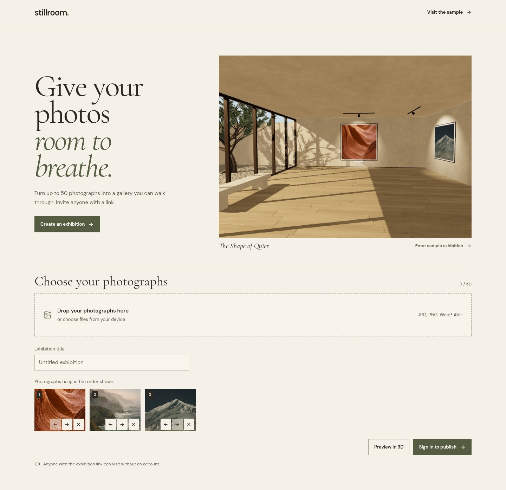
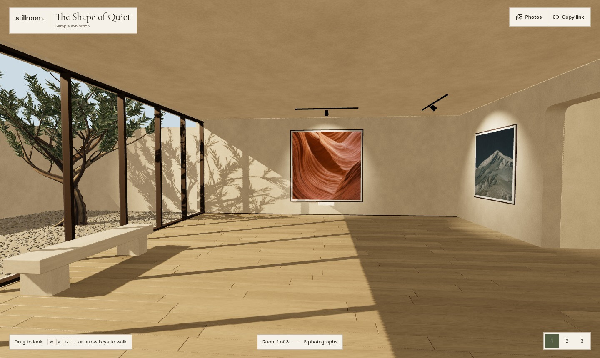
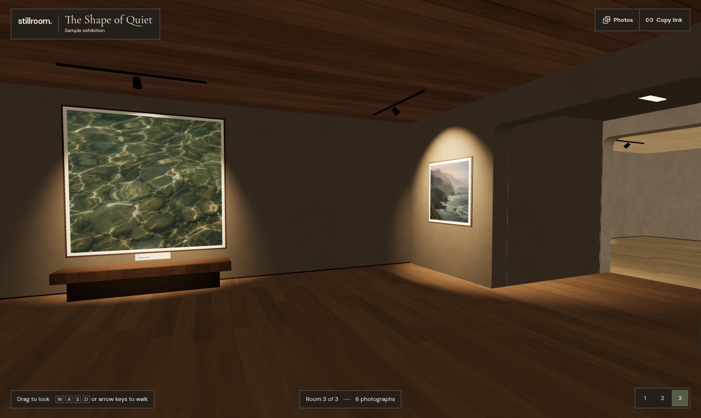
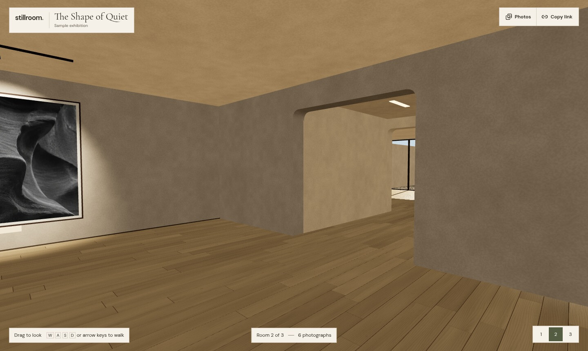
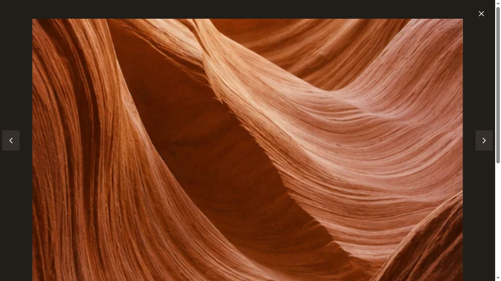
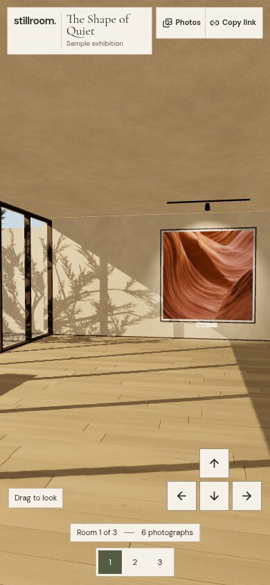

# Stillroom · 3D Art Gallery

Stillroom turns a collection of up to 50 photographs into a walkable, first-person exhibition. Upload the work, preview how it hangs, and share a link visitors can open in their browser.

**[Create an exhibition](https://stillroom-photo-gallery.benclawbot.chatgpt.site/) · [Walk through the sample](https://stillroom-photo-gallery.benclawbot.chatgpt.site/g/demo)**

## See it in use

### Exhibition creator

Choose JPG, PNG, WebP, or AVIF files. Add a title and reorder the photographs before previewing the layout.



### Courtyard entrance

Bronze glazing looks onto an olive courtyard. Daylight throws the tree and window-frame shadows across the warm oak floor beside a low limestone bench. The sample exhibition, *The Shape of Quiet*, hangs six generated photographs across three rooms.



### Print wing

The last room of a multiroom exhibition pairs a flat timber ceiling with smoked oak boards, warm spotlights, and a low wooden bench beneath the featured print.



### Passages between rooms

Larger exhibitions get rooms with varied footprints, offset thresholds, and branching routes. The numbered room controls also let visitors jump directly to a room.



### Close look and mobile controls

Select a print in the room or choose it from **Photos**. The close-up fits the entire image and provides previous and next controls.





## Create and visit

1. Add between 1 and 50 photographs to the creator.
2. Set an exhibition title, then use the thumbnail arrows to adjust the order.
3. Choose **Preview in 3D** to walk through the draft locally.
4. Sign in with ChatGPT and select **Publish gallery**. The creator restores the draft after sign-in.
5. Choose **Copy link** in the published gallery. Guests with the link can visit without an account.

| Action | Desktop | Phone or tablet |
| --- | --- | --- |
| Look around | Drag the room. The scene follows horizontal drags. | Drag the room with one finger. |
| Walk | Use WASD or the arrow keys. | Tap or hold a direction on the on-screen pad. |
| Inspect a photograph | Click a frame or select a work from **Photos**. | Tap a frame or select a work from **Photos**. |
| Change rooms | Walk through a passage or use the room selector. | Walk through a passage or use the room selector. |
| Close an artwork | Press Escape or use the close button. | Use the close button. |

The 3D viewer uses WebGL 2. The **Photos** index provides a browser-based way to view every work when 3D is unavailable.

## How it works

- **Floor plans.** The number of supplied photographs determines the room count, with up to seven rooms in a 50-photo exhibition. The ordered aspect ratios seed a deterministic layout with varied room dimensions and positions. Connected corridors make every room walkable. Wall placement reserves door clearance and keeps the original image proportions.
- **Renderer.** Three.js draws the scene at eye level. The courtyard uses a static shadow map for the glazing and the olive tree. Procedural materials and custom GLSL give the oak floors varied boards, long grain, small knots, and a soft sheen. The print wing uses darker smoked oak and a fixed budget of warm spotlights. The renderer redraws when the camera, viewport, or image textures change. The photograph surfaces use sRGB textures and retain their original color balance.
- **Drafts.** The browser prepares web-sized photographs for display and saves the draft in IndexedDB. It uploads each photograph separately after the creator chooses to publish.
- **Publishing.** A Cloudflare Worker stores uploads in an R2 bucket. It verifies that all of the creator's photographs are present before publishing the exhibition manifest. Public links serve that manifest and its photographs. Upload and publish routes require the creator's authenticated session.

| Source | Responsibility |
| --- | --- |
| [`app/page.tsx`](app/page.tsx) | Photo selection, ordering, draft preview, and publishing |
| [`app/exhibition.tsx`](app/exhibition.tsx) | Gallery controls, room selection, and the photo viewer |
| [`app/world.tsx`](app/world.tsx) | Camera, mouse and touch input, and frame selection |
| [`app/lib/gallery-layout.ts`](app/lib/gallery-layout.ts) | Room graph, corridors, and artwork placement |
| [`app/lib/gallery-scene.ts`](app/lib/gallery-scene.ts) | Scene assembly, lighting, collision, and texture loading |
| [`app/lib/scene-finishes.ts`](app/lib/scene-finishes.ts) | Procedural materials, oak floor geometry, and GLSL |
| [`app/lib/olive-tree.ts`](app/lib/olive-tree.ts) | Procedural branches and instanced olive foliage |
| [`app/api/gallery/`](app/api/gallery/) | Upload, publication, and public readback |

## Run it locally

Use Node.js 22.13 or later and npm.

```sh
npm ci
npm run dev
```

Open the Local URL printed by Vinext. Go to `/g/demo` to walk through the sample or use the homepage to create a test exhibition. Loopback development uses a test sign-in and local object storage through the Sites development integration.

```sh
npx tsc --noEmit
npm run build
```

The production build generates the Worker entry point and client assets in `dist/`. The hosted app uses ChatGPT Sites request identity and the R2 binding named `BUCKET`. Configure a new Sites deployment with its own project ID and R2 binding. The live installation is available on [ChatGPT Sites](https://stillroom-photo-gallery.benclawbot.chatgpt.site/).

## Design references

- César Pelli’s Madison Museum of Contemporary Art informed the view through glazing and the relationship between the interior and the outdoors. [Madison Museum of Contemporary Art](https://www.mmoca.org/events/iconic/)
- Jeu de Paume’s *Fragile Beauty* offered a reference for lighting and hanging individual prints in a dedicated photography exhibition. [Jeu de Paume exhibition](https://jeudepaume.org/en/evenement/fragile-beauty/)

- Image in Progress's *Underwater Photography* informed the first-person viewing and close-up artwork interaction. [Image in Progress virtual exhibitions](https://www.imageinprogress.com/exhibitions.html)
- Galerra showed how a direct room selector and a separate catalogue can complement a walkthrough. [Dan's Gallery on Galerra](https://galerra.art/gallery/dan-s-gallery-6k21ae2wn10ip0v)
- Olivier Cornet Gallery informed the option to browse individual works alongside a free walk. [Olivier Cornet 3D virtual space](https://oliviercornetgallery.com/3D-virtual-space)
